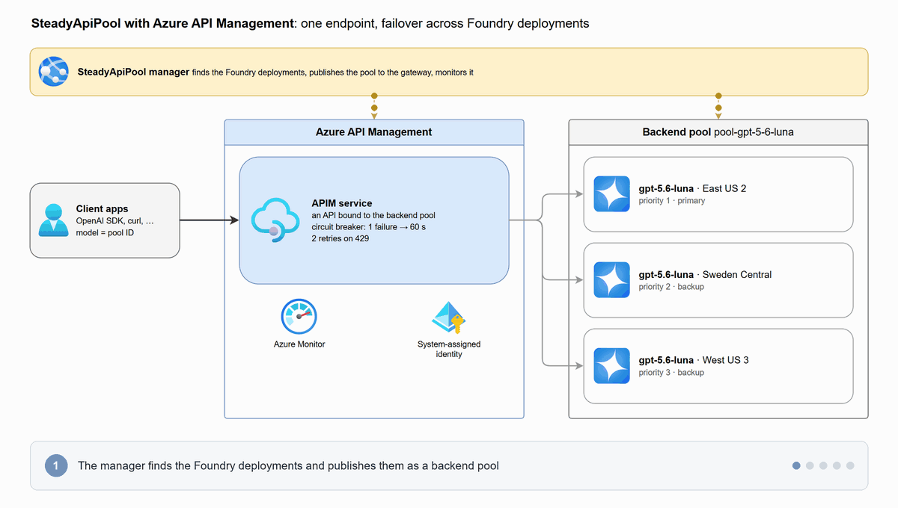
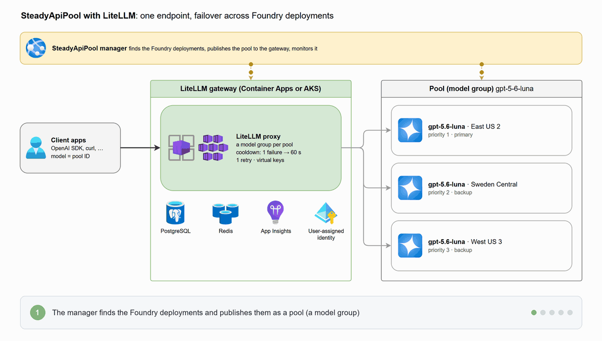

# SteadyApiPool

**English** | [简体中文](README.zh-CN.md)

A standalone web app that gives you an **AI gateway with failover** in front of your Azure OpenAI /
Foundry model deployments, without having to learn the gateway or Foundry first. It finds your
model deployments and groups deployments of one model into a **pool**. Clients call the pool at
one endpoint; the gateway spreads requests across the members (failover, balanced or weighted),
benches a member that keeps failing, and retries on another member.

You choose the gateway on the setup page:

- **[Azure API Management](https://learn.microsoft.com/azure/api-management/) (APIM)**, with its
  native backend pools, circuit breakers and session affinity. The app uses an APIM service you
  have, or creates one, and binds each pool to an API.
- **A [LiteLLM](https://github.com/BerriAI/litellm) gateway**, an open-source AI gateway. The app
  deploys it on Azure Container Apps or AKS, or connects one you already run, and gives clients
  OpenAI-style model names, aliases and virtual keys.


*One endpoint for clients, several model deployments behind it: the Routing tab shows how the
gateway routes traffic through the pool, and lets you click a deployment to see what happens when
it fails or is throttled.*

## Which gateway?

<table>
  <tr>
    <th width="50%">Azure API Management</th>
    <th width="50%">LiteLLM (Container Apps or AKS)</th>
  </tr>
  <tr>
    <td><a href="images/apim-architecture.gif"></a></td>
    <td><a href="images/litellm-architecture.gif"></a></td>
  </tr>
</table>

*The same pool on each gateway: the primary answers 429, the gateway retries on the next member and
benches the primary for 60 s, then takes it back.*

| | Azure API Management | LiteLLM |
| --- | --- | --- |
| Pick it when | Your organization already runs APIM, or wants a managed Azure service with its policies, products and portal | You want an OpenAI-style endpoint with model names, aliases and per-key limits, or an open-source gateway you can run anywhere |
| What the app sets up | An APIM service (yours, or a new Basic v2 one), a `Pool` backend per pool and an API bound to it | A LiteLLM proxy with PostgreSQL on Container Apps (one step) or a new AKS cluster, or a connection to yours; a model group per pool |
| How clients call it | `https://<apim>.azure-api.net/<api-path>/chat/completions?api-version=…` with `Ocp-Apim-Subscription-Key` | `https://<gateway>/v1/chat/completions` with a virtual key and the pool ID (or an alias) as the model |
| Failure handling | A circuit breaker per member, retries in the API's policy, optional session affinity | Cooldown per member, retries on another member, Responses API follow-ups pinned to the deployment that answered |
| Cost | The service's tier (Basic v2 is the suggested start; Developer has no SLA), billed by the hour | From about $46 a month for one Container Apps replica; the sizer prices the plan for your traffic in your region before you deploy (list prices) |
| Also available as | The [public app](docs/deploy.md#public-app-on-azure-container-apps), where anyone signs in with their own Azure account | — |

Both kinds manage the same Foundry deployments with the same identity rules (the gateway calls
them with its managed identity, no keys), and you can switch between them on the setup page.

### How much traffic?

Measured on Azure (October 2026), each gateway as the app sets it up, loaded from a VM in its
region; requests a minute it carried, and the median latency it added at 600 a minute:

| | APIM Basic v2 | APIM Standard v2 | LiteLLM on Container Apps | LiteLLM on AKS |
| --- | --- | --- | --- | --- |
| Streamed chat (2,000 tokens in, 500 out) | 4,500 | 12,000 | 3,720 | 11,280 |
| Short answers, not streamed | ≥ 22,500 | ≥ 22,500 | ≥ 22,500 | ≥ 15,000 |
| Agent loop steps (50,000 tokens in) | 10,500 | 16,860 | ≥ 22,500 | ≥ 15,000 |
| Added latency (median) | under 10 ms | under 10 ms | 20–70 ms | 20–60 ms |

When a deployment answered 429 or 500, both gateways moved its traffic to the next one within a
second; with a real model, every pool answered all calls past one deployment's quota, where that
deployment alone turned up to 65% away. The sizes, prices, failover details and the method are in
[Benchmarks](docs/benchmarks.md).

## Quick start

The app runs on your computer and needs only **Python**: no Azure CLI, Node.js, Docker or config
file, and no APIM or LiteLLM experience. It checks what's missing and fixes it with you. It takes
ten minutes to half an hour, most of it Azure creating the gateway if you don't have one. Every
option of every step is in the [step-by-step guide](docs/getting-started.md).

**What you need**

- **Python 3.11 or newer**: `winget install -e --id Python.Python.3.13` on Windows,
  `brew install python@3.13` on macOS, or see
  [Prerequisites per OS](docs/development.md#prerequisites-per-os).
- **An Azure account** that can manage an existing gateway or create one (*Contributor*), and read
  your Azure OpenAI / Foundry resources (*Reader*).
- **Some Azure OpenAI / Foundry model deployments**, ideally of one model in several regions. The
  app can create them.

### 1. Download and start

Download `SteadyApiPool-<version>.zip` from
[Releases](https://github.com/guming3d/SteadyApiPool/releases), unzip it, and run:

```powershell
scripts\start-local.cmd        # Windows
```

```sh
scripts/start-local.sh         # macOS, Linux, WSL
```

The first run installs what the app needs (about a minute). Then open **http://127.0.0.1:8000**.

Next, follow the [quick start](docs/quick-start.md) from step 2: sign in, choose or deploy
the gateway, pool your deployments, publish the pool and send the first call, with a
screenshot of each step.

> [!CAUTION]
> The app acts on Azure as **you**, on your **real** gateway (and, for LiteLLM, with its master
> key). Changes are live for every client at once.

## Documentation

- [Quick start](docs/quick-start.md): steps 2–8 with a screenshot each: sign in, choose or
  deploy the gateway, create and publish a pool, get a key, send the first call and watch the
  metrics.
- [Step-by-step guide](docs/getting-started.md): every option of each step, deploying a LiteLLM
  gateway on Container Apps or AKS, client code, the load test, troubleshooting, and a demo that
  runs without Azure.
- [Features and how it works](docs/features.md): everything the app does, how a pool maps to APIM
  and to LiteLLM, and what a LiteLLM gateway deployment creates and how it's maintained.
- [Benchmarks](docs/benchmarks.md): how much each gateway carries, the latency it adds and what
  clients see when a deployment fails, measured on Azure.
- [Host it in Azure](docs/deploy.md): App Service for a team with `azd`, and the public
  multi-tenant app.
- [Run it locally and develop](docs/development.md): prerequisites per OS, sign-in, proxies and
  certificates, WSL, the project layout, and the tests.
