# SteadyApiPool

**English** | [简体中文](README.zh-CN.md)

A standalone web app that gives you an **AI gateway with failover** in front of your Azure OpenAI /
Foundry model deployments, without having to learn the gateway or Foundry first. It finds your
model deployments and groups deployments of one model into a **pool**. Clients call the pool at
one endpoint; the gateway spreads requests across the members (failover, balanced or weighted),
benches a member that keeps failing, and retries on another member.

You choose the gateway on the setup page:

- **[Azure API Management](https://learn.microsoft.com/azure/api-management/) (APIM)**, with its
  native backend pools, circuit breakers and session affinity. The app uses an APIM service you
  have, or creates one, and binds each pool to an API.
- **A [LiteLLM](https://github.com/BerriAI/litellm) gateway**, an open-source AI gateway. The app
  deploys it on Azure Container Apps or AKS, or connects one you already run, and gives clients
  OpenAI-style model names, aliases and virtual keys.

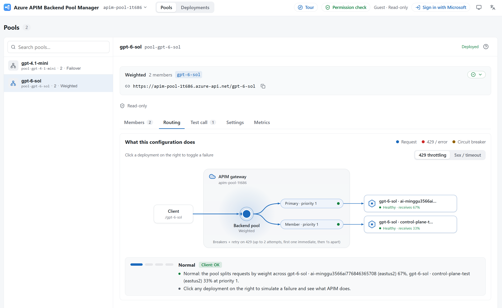

*One endpoint for clients, several model deployments behind it: the Routing tab shows how the
gateway routes traffic through the pool, and lets you click a deployment to see what happens when
it fails or is throttled.*

```
SteadyApiPool/
├── backend/    FastAPI app (pool_manager: shared code, apim/ and litellm/) + tests; serves the
│               built frontend
├── frontend/   React/Vite UI (src/apim, src/litellm and the shared rest; built into
│               backend/pool_manager/static)
├── infra/      Bicep: the LiteLLM gateway on Container Apps and AKS (infra/gateway), and the App
│               Service hosting of this app with Easy Auth and least-privilege roles
├── deploy/     The public multi-tenant app on Container Apps (APIM only; its own azd project)
├── scripts/    Local start scripts, the doctor, the demo server, the load test, release
│               packaging and the gateway template build
├── docs/       Screenshots for this README
└── azure.yaml  azd project definition (App Service hosting)
```

New here? [Get started](#get-started) takes ten minutes to half an hour (most of it waiting for
Azure to create the gateway, if you don't have one) and needs only Python.

## Which gateway?

| | Azure API Management | LiteLLM |
| --- | --- | --- |
| Pick it when | Your organization already runs APIM, or wants a managed Azure service with its policies, products and portal | You want an OpenAI-style endpoint with model names, aliases and per-key limits, or an open-source gateway you can run anywhere |
| What the app sets up | An APIM service (yours, or a new Basic v2 one), a `Pool` backend per pool and an API bound to it | A LiteLLM proxy with PostgreSQL on Container Apps (one step) or a new AKS cluster, or a connection to yours; a model group per pool |
| How clients call it | `https://<apim>.azure-api.net/<api-path>/chat/completions?api-version=…` with `Ocp-Apim-Subscription-Key` | `https://<gateway>/v1/chat/completions` with a virtual key and the pool ID (or an alias) as the model |
| Failure handling | A circuit breaker per member, retries in the API's policy, optional session affinity | Cooldown per member, retries on another member, Responses API follow-ups pinned to the deployment that answered |
| Cost | The service's tier (Basic v2 is the suggested start; Developer has no SLA), billed by the hour | Container Apps about $46–115 a month (dev) or $171–865 (production); a new AKS cluster about $190–1,200 (list prices) |
| Also available as | The [public app](#public-app-on-azure-container-apps), where anyone signs in with their own Azure account | — |

Both kinds manage the same Foundry deployments with the same identity rules (the gateway calls
them with its managed identity, no keys), and you can switch between them on the setup page.

## Get started

This guide runs the app on your own computer. You install Python and nothing else. You don't
need the Azure CLI, Node.js, Docker, a config file, or any APIM or LiteLLM experience; the app
checks what's missing and fixes it with you. (To give your team a shared URL instead, see
[Deploy to Azure](#deploy-to-azure).)

**What you need**

- **Python 3.11 or newer.** `winget install -e --id Python.Python.3.13` on Windows,
  `brew install python@3.13` on macOS, or see [Prerequisites per OS](#prerequisites-per-os).
- **An Azure account** that can manage an existing gateway (an APIM service or a LiteLLM
  gateway's Container App), or create one in a subscription (*Contributor*), and read your Azure
  OpenAI / Foundry resources (*Reader*).
- **Some Azure OpenAI / Foundry model deployments**, ideally of the same model in more than one
  region. If you don't have any, the app can create them (step 4).

### 1. Download and start

Download `SteadyApiPool-<version>.zip` from
[Releases](https://github.com/guming3d/SteadyApiPool/releases), unzip it, and run
the start script in the unzipped folder:

```powershell
scripts\start-local.cmd        # Windows
```

```sh
scripts/start-local.sh         # macOS, Linux, WSL
```

The first run checks your machine and installs what the app needs into a local `.venv`, which
takes about a minute. Then open **http://127.0.0.1:8000**. Keep the window open while you use
the app, and press Ctrl+C to stop it.

### 2. Sign in to Azure

Click **Sign in with browser** and sign in with your Azure account. On a machine without a
browser (SSH, WSL, a server), click **Use a code instead**. The app remembers the sign-in in your
OS's encrypted store, so you do this once.

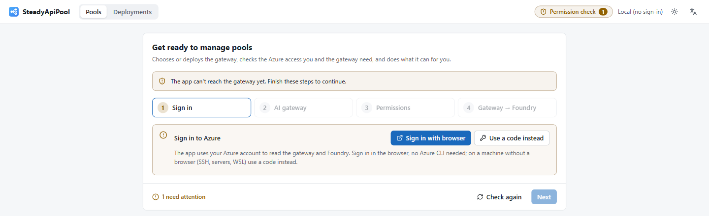

### 3. Choose the kind of gateway, then the gateway

Pick **LiteLLM gateway** or **Azure API Management** (see
[Which gateway?](#which-gateway)); you can switch later. The app then lists the gateways of that kind in each
subscription you can access and says whether you may manage them.

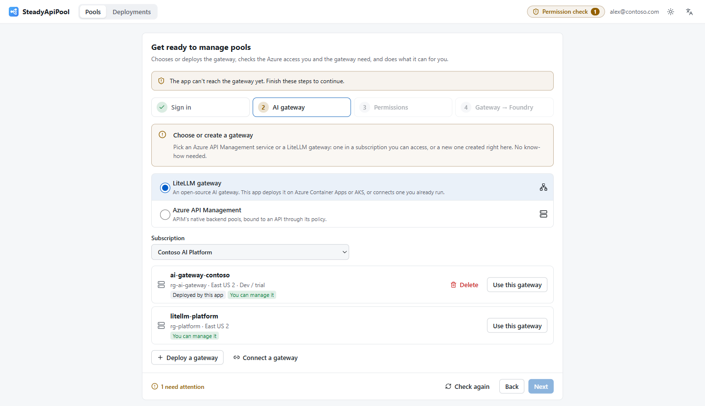

#### Azure API Management

Click **Use this service** on the APIM service you want.

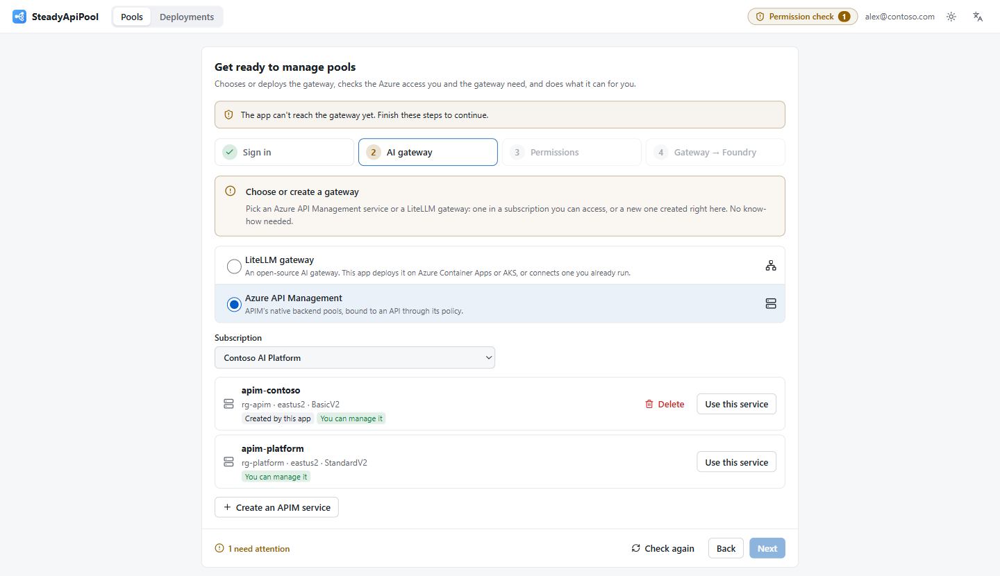

No APIM service yet? Click **Create an APIM service**. Everything is filled in: a unique name,
a new resource group, a region and the recommended **Basic v2** tier. Check the publisher
email and click **Create and use**. The app waits until the service is ready, usually a few
minutes (the Developer tier takes 30–40). Azure bills the service from the moment it's created.

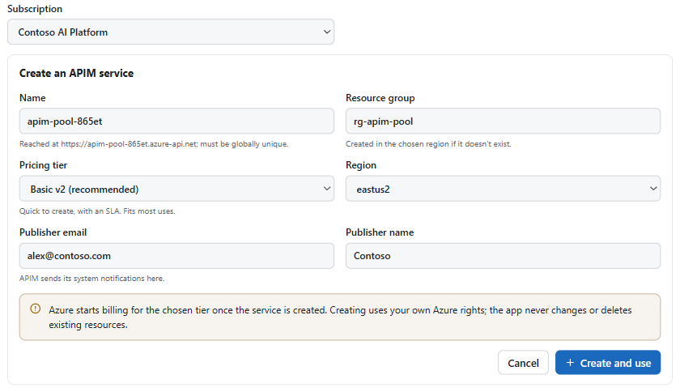

#### LiteLLM gateway

Click **Use this gateway** on a LiteLLM gateway on Azure Container Apps.

No gateway yet? Click **Deploy a gateway**. The app first asks **Where should the gateway run?**
(see [Container Apps or AKS?](#container-apps-or-aks) below) and recommends one:

- **Deploy on Container Apps** opens a form with everything filled in: a unique name, a resource
  group, a region and the size (**Dev / trial** or **Production**), with a list-price estimate.
  Click **Deploy**. The app deploys LiteLLM, PostgreSQL, a managed identity and Application
  Insights with your own Azure rights, and follows the deployment, which usually takes 5–15
  minutes (PostgreSQL is the slowest). You can close the app meanwhile; setup picks it up again.
  Azure bills the resources from the moment they're created.
- **Deploy on AKS** opens the same form for a **new AKS cluster**. Click **Deploy**; the app
  then works in three phases, shown as it goes (usually 15–25 minutes in all):
  1. **Azure resources**: the cluster (Entra ID with Azure RBAC, workload identity, the managed
     Gateway API), PostgreSQL, the gateway's identity, Application Insights and, for production,
     Redis. You get *Azure Kubernetes Service RBAC Cluster Admin* on the cluster, so deploying
     needs Owner or User Access Administrator on the resource group.
  2. **Install in the cluster**: through AKS Run Command (no kubectl or Helm needed on your
     machine) the app installs cert-manager, an OpenTelemetry Collector, LiteLLM's Helm chart and
     an HTTPS Gateway.
  3. **HTTPS certificate**: Let's Encrypt issues a certificate for
     `https://<name>.<region>.cloudapp.azure.com`; once LiteLLM answers there, the app connects
     to it like any gateway.

  Keep the page open while it runs (the progress drives the install on; if you close it, come
  back to the **AI gateway** step). If the install fails, its output is shown with **Run the
  install again**. After that the cluster is **yours to maintain**; see
  [A LiteLLM gateway on AKS](#a-litellm-gateway-on-aks).
- **Use my own cluster (files)** is for a cluster you already have: it asks for the cluster, its
  resource group and a namespace, and generates a `values.yaml`, a `deploy.sh` and a `README.md`
  (Helm chart, workload identity, PostgreSQL Flexible Server). The cluster needs the OIDC issuer
  and workload identity enabled. Run the script, for example in Azure Cloud Shell, then click
  **Deployed, connect it**. The script exposes LiteLLM on plain HTTP on a public IP, and
  **Connect** accepts only HTTPS URLs (plain HTTP only for localhost, so the master key never
  crosses the network unencrypted). To try it from the machine running the app, keep
  `kubectl -n <namespace> port-forward svc/litellm 4000:4000` running and connect to
  `http://localhost:4000`; for real traffic, put HTTPS in front and connect to its HTTPS URL.

**Connect a gateway** works for any LiteLLM proxy with a database (`STORE_MODEL_IN_DB`): enter its
HTTPS URL, its master key and, optionally, the object ID of the managed identity it calls Foundry
as and its Application Insights resource ID. The app checks both against the gateway and keeps the
master key encrypted on this machine, never in a file in plain text.

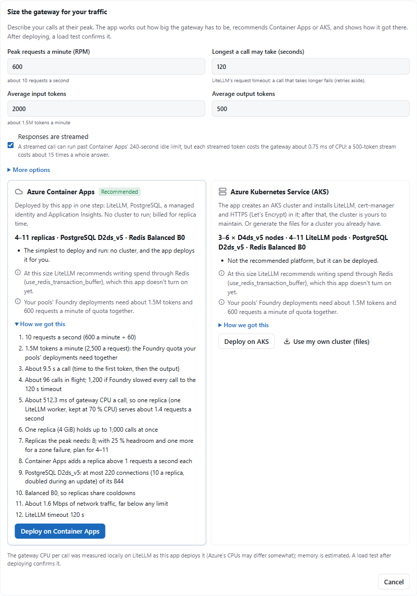

A two-minute guided tour opens next. Take it or skip it; **Tour** in the top bar replays it.

##### Container Apps or AKS?

The questionnaire asks what the gateway is for, the peak tokens per minute, the average tokens per
request, and three yes/no questions. It recommends:

| | Azure Container Apps (the default) | Azure Kubernetes Service (AKS) |
| --- | --- | --- |
| When | Most cases: trials, and production traffic up to about 250 requests a second (what the production profile's 5 replicas serve) | You already run an AKS cluster and have people for it; self-hosted (GPU) models should run next to the gateway; or the peak is over about 250 requests a second (peak TPM ÷ 60 ÷ tokens per request) |
| How | Deployed by this app in one step, with no cluster to run | A new cluster deployed and set up by this app (then maintained by you), or the generated files for a cluster you already have |
| Size | **Dev / trial**: one replica, no Redis. **Production**: 2–5 replicas scaling with load, sharing cooldowns through Redis | **Dev / trial**: one Standard_D4ds_v5 node, Free tier, no Redis. **Production**: 3–6 nodes across zones, Standard tier (uptime SLA), 2–6 LiteLLM replicas sharing cooldowns through Redis |
| List price | Dev about **$46–115 a month**; production about **$171–865 a month** | New cluster: dev about **$190–230 a month**; production about **$670–1,200 a month**. Your own cluster: its cost, plus PostgreSQL |

The prices are **retail list-price estimates** (USD, East US 2, from quiet to busy) for what each
profile deploys: Container Apps replicas, PostgreSQL and, for production, Redis. They leave out
free grants, log ingestion and discounts, and of course your model usage, which Foundry bills as
usual. Once the gateway exists, its panel shows this month's actual spend and the list price for
its region. For production the recommendation also says how many replicas to plan for (about one
per 50 requests a second at the peak).

A gateway that must not be reachable from the internet works on both, but private networking
isn't automated here: on Container Apps, put the environment in a virtual network afterwards (or
adapt the template); on AKS, use an internal load balancer or private ingress.

### 4. Pick the deployments to pool

Open the **Deployments** tab. It lists every Azure OpenAI / Foundry deployment in the gateway's
subscription, grouped by model. (Deployments in other subscriptions: set
`POOL_MANAGER_DISCOVERY_SUBSCRIPTIONS` in `backend/.env`.) Click **Create pool from this model**
on the model you want. To pool only some of a model's deployments, tick them and choose
**Import & create pool**.

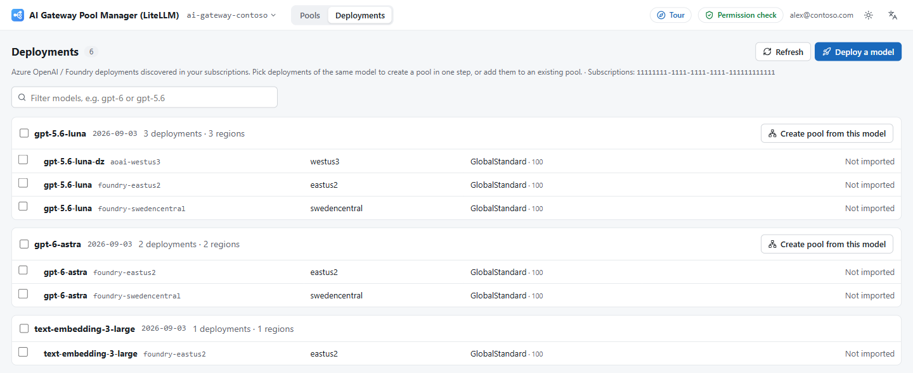

Nothing deployed yet? **Deploy a model** creates a deployment in one of your Foundry resources,
then lists it here.

### 5. Publish the pool

The pool opens with everything filled in and the defaults work:

- **APIM:** an ID, an API path that clients will call, the members and a circuit breaker.
- **LiteLLM:** an ID (here `pool-gpt-5-6-luna`), which is also the model name clients send, the
  members, and the cooldown, retry and timeout settings.

**Failover** sends all traffic to the primary and switches to a standby when it fails or runs out
of quota; choose **Balanced** to spread traffic over every member instead, or **Weighted** to set
the shares.

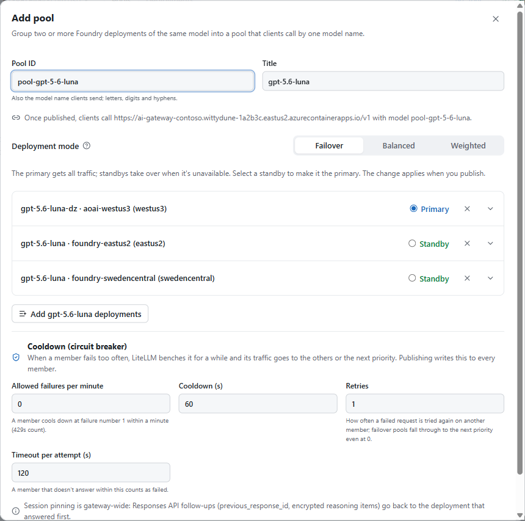

Click **Publish to APIM** (or **Publish to the gateway**). The app lists exactly what it will
write. Click it again to confirm. Changes take effect on the gateway immediately.

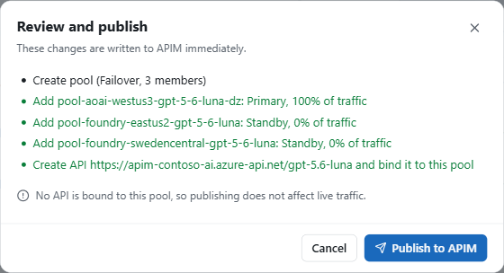

### 6. Let the gateway call your models, and get a key

The pool opens on its **Test call** tab, which walks you through the rest:

1. **Grant all** gives the gateway's managed identity (APIM's, or the LiteLLM gateway's) the
   *Cognitive Services OpenAI User* role on each Foundry resource, so it calls your models
   without API keys. That takes a role allowed to assign roles on those resources (*Owner*, *User
   Access Administrator* or *Role Based Access Control Administrator*). Without one,
   **Permission check** in the top bar shows a ready-to-send request for your Azure admin. On
   APIM, setup first turns on the service's managed identity if it is off.
2. **Create a test key** gets a key that can call only this pool:
   - **APIM:** a subscription key that opens only the pool's API.
   - **LiteLLM:** a virtual key that can call only the pool's model names. LiteLLM keeps only a
     hash of it, so copy it now if you want to keep it: it's shown this once. **Add an alias**,
     above it, lets clients that already send another model name, such as `gpt-5.6-luna`, reach
     the pool.

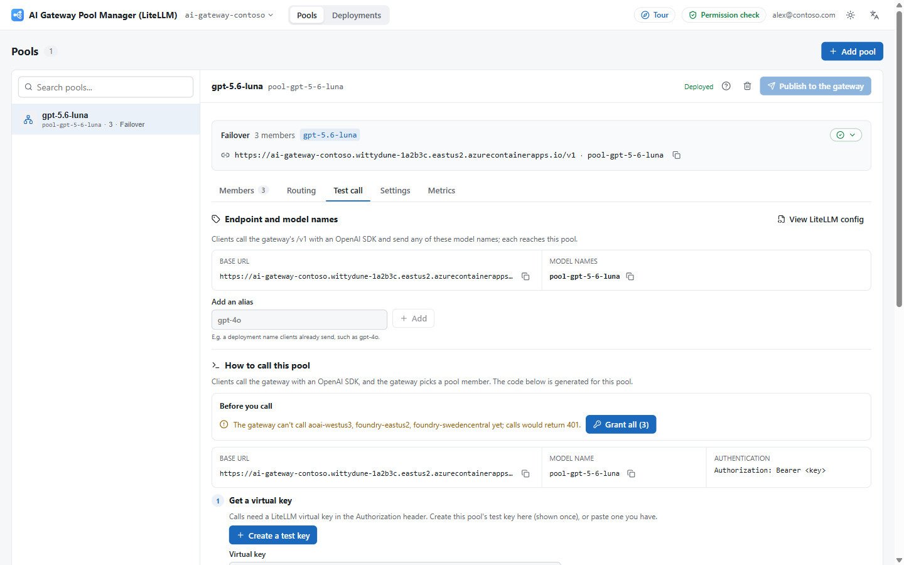

### 7. Send a test request

Click **Send request**. The request goes through the gateway and the pool, and you get the
model's answer with the member that served it (on LiteLLM, also how many times it tried other
members first). If you only just granted access, Azure can take up to 10 minutes to apply the
role; until then the page explains the error, so try again shortly.

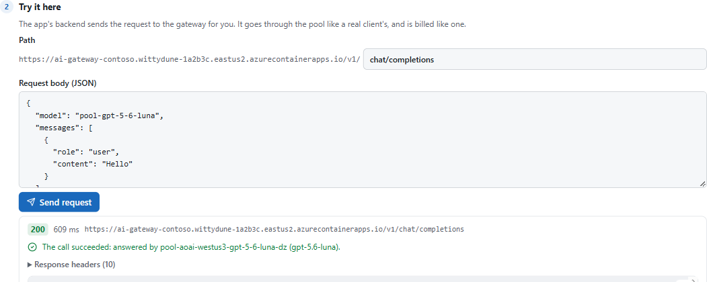

Your apps call the pool like any OpenAI endpoint. **Send a request**, further down, has the code
for curl, Python, JavaScript and PowerShell with your URL filled in. In Python, through APIM:

```python
from openai import OpenAI

client = OpenAI(
    base_url="https://<your-apim>.azure-api.net/<api-path>",
    api_key="unused",  # The SDK needs a value; APIM sends its own token to Azure OpenAI
    default_headers={"Ocp-Apim-Subscription-Key": "<your-subscription-key>"},
    default_query={"api-version": "2025-04-01-preview"},
)
response = client.chat.completions.create(
    model="gpt-5.6-luna", messages=[{"role": "user", "content": "Hello"}]
)
print(response.choices[0].message.content)
```

Through LiteLLM (base URL `<gateway>/v1`, the virtual key, the pool ID or an alias as the model,
and no `api-version`):

```python
from openai import OpenAI

client = OpenAI(base_url="https://<your-gateway>/v1", api_key="<your-virtual-key>")

response = client.chat.completions.create(
    model="pool-gpt-5-6-luna",
    messages=[{"role": "user", "content": "Hello"}],
)
print(response.choices[0].message.content)
```

### Load-test the pool (optional, LiteLLM)

**Load test**, under Try it here, simulates several users calling the pool at once: each sends a
request, waits for the answer, then sends the next. Pick **Smoke** (2 users, 30 s), **Typical**
(10 users, 2 min) or **Stress** (30 users, 3 min), or set the users, duration, ramp-up, a rate cap,
the prompt size, `max_tokens` and streaming under **Advanced settings**. The page estimates the
requests and tokens first; every request is billed by Foundry like real traffic and counts against
the deployments' rate limits. While it runs you see throughput, the success rate, latency p50/p95/
p99, time to first token, 429s and failovers, a chart per second and which members answered; at
the end a plain verdict (for example that the pool needs more capacity because every member
returned 429 at once), **Export JSON / CSV** and the same test as a terminal command. A run is
limited to 50 users, 10 minutes and 5,000 requests, one at a time, and only owners can start one.

From a terminal, against this or any OpenAI-compatible endpoint (the key stays in an environment
variable, out of the shell history):

```powershell
$env:LITELLM_KEY = "<your-virtual-key>"
backend\.venv\Scripts\python scripts\benchmark.py --url https://<your-gateway>/v1 --model pool-gpt-5-6-luna --preset typical
#   --users 20 --duration 120 --ramp-up 10 --rate 15 --prompt long --max-tokens 256 --no-stream
#   --json result.json --csv requests.csv        (macOS/Linux: backend/.venv/bin/python, export LITELLM_KEY=...)
```

It prints a status line every second and the report at the end; Ctrl+C stops it (requests already
sent finish) and still prints the report. `--i-know` lifts the limits for the terminal only.

### 8. Watch it work

The **Metrics** tab shows requests, availability, the 429s that reached clients (on LiteLLM, also
how many a failover saved) and latency, plus each member's share of the traffic and tokens.
**Routing** simulates a member failing, so you can see the failover before it happens for real.

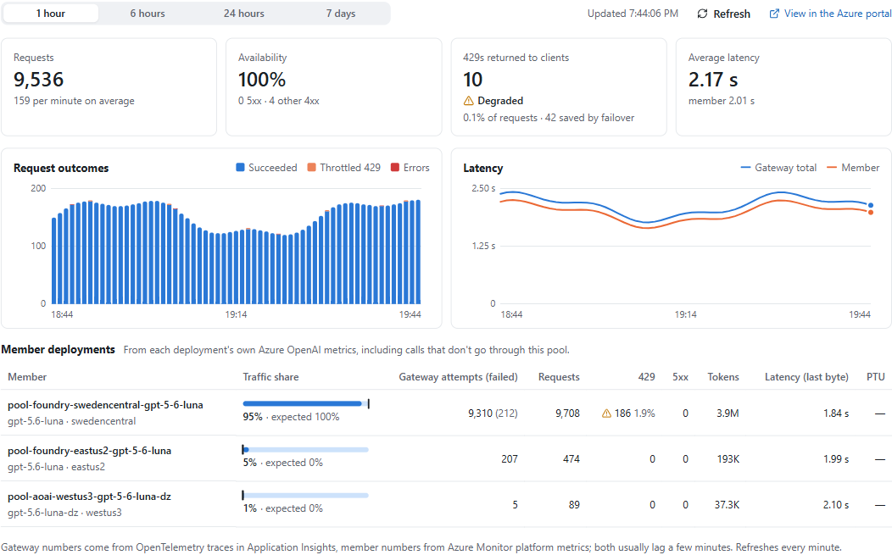

That's it. Everything else (more pools, weights, session affinity or aliases, binding your own
APIs, custom endpoints, cleaning up) is in the same UI; [What it does](#what-it-does) lists it
all.

> [!CAUTION]
> The app acts on Azure as **you**, on your **real** gateway (and, for LiteLLM, with its master
> key). Changes are live for every client at once.

**If something gets in the way**

- **Permission check** in the top bar re-runs the setup checks. Whatever your own Azure rights
  can't fix becomes a request to send your admin: the role, the scope, an `az` command and a
  portal link.
- `python scripts/doctor.py` explains what's wrong with your machine or network (Python version,
  proxy, company TLS certificates, DNS) and how to fix it on your OS.
- Behind a proxy or on a locked-down network? See
  [Networks, proxies and certificates](#networks-proxies-and-certificates).

**Try it without Azure.** From a clone, `scripts/demo_server.py` runs the same UI against an
in-memory Azure, APIM and LiteLLM gateway with sample deployments, which is how the screenshots
above were made. Nothing reaches Azure. It needs the backend's virtual environment (the start
script creates it) and the built UI (Node.js 22+):

```sh
cd frontend && npm ci && npm run build && cd ..
backend/.venv/Scripts/python scripts/demo_server.py    # bin/python on macOS and Linux; http://127.0.0.1:8010
```

It starts signed out, like a first run. `POST /demo/stage/{sign-in,ready,pool}?product=apim` (or
`litellm`) jumps to a point in onboarding (`pool` is a pool already in use, with an hour of
metrics); `--product` and `--stage` choose where it starts.

## What it does

| Area | What it does |
| --- | --- |
| **Setup wizard** | Four steps: **Sign in**, the gateway (**AI gateway** or **APIM service**), **Permissions** and **Gateway → Foundry**. It checks sign-in, the gateway (for LiteLLM: reachable, database connected, master key valid), its managed identity, your access to it and the gateway's access to Foundry. It fixes what your Azure rights allow and writes a ready-to-send admin request for the rest. Locally it also chooses the kind of gateway, and picks, creates, connects or deletes the gateway. |
| **Gateway choice** | APIM: an existing service, or a new one. LiteLLM: recommends Container Apps or AKS from a few answers, deploys on Container Apps in one step, or creates a new AKS cluster and installs LiteLLM with HTTPS on it, or generates the files for a cluster you already have, or connects any LiteLLM proxy. |
| **Guided tour** | A two-minute walkthrough for people new to AI gateways. It runs once after setup; **Tour** in the top bar replays it. |
| **Deployment discovery** | Lists the Azure OpenAI / Foundry deployments in your subscriptions, grouped by model, and imports the ones you select into a new or existing pool. |
| **Deploy a model** | Creates a pay-per-token OpenAI model deployment in a Foundry account, using your own Azure rights, so you don't need the Foundry portal. |
| **Pools** | Create and edit pools of 2–30 members in **Failover**, **Balanced** or **Weighted** mode. On APIM a pool is a `Pool` backend, with optional session affinity; on LiteLLM it is a model group whose ID is the model name clients send. |
| **Members** | Edited inside their pool. Besides Foundry deployments, you can add any OpenAI-compatible endpoint (on LiteLLM with no auth, an API key stored by LiteLLM as an encrypted credential, or the gateway's managed identity). Members the app created go once no pool uses them. |
| **Failure handling** | A pool setting written to every member. APIM: one circuit breaker rule. LiteLLM: the cooldown (how many failures in a minute bench a member, and for how long), retries on another member and the timeout per attempt. |
| **Pool API (APIM)** | Creating a pool also creates and binds an HTTP API for it, so clients have an endpoint right away. **API binding** points an existing API at a pool through its policy, with a diff preview first; unbinding restores the original policy byte for byte. |
| **Model names and aliases (LiteLLM)** | The pool ID always works; aliases point other model names at the pool, so existing clients don't have to change. **View LiteLLM config** shows the pool as a LiteLLM `config.yaml` would write it (secrets left out), with a diff before you publish, and **Export YAML**. |
| **Routing preview** | Shows how the gateway routes traffic through the pool and simulates failures, breaker trips or cooldowns, and recovery. |
| **Test call** | Gets a test key (an APIM subscription key, or a LiteLLM virtual key), sends a test request from the page, shows which member answered, and gives ready-to-copy client code. |
| **Load test (LiteLLM)** | Simulated users calling the pool, from the Test call tab or `scripts/benchmark.py`: throughput, latency and time-to-first-token percentiles, 429s, failovers and the members that answered, with a verdict and exports. |
| **Metrics** | Requests, availability, 429s and latency for the pool (from APIM's Azure Monitor metrics, or the LiteLLM gateway's OpenTelemetry traces in Application Insights), plus traffic share, tokens and latency per member from Azure Monitor. |
| **Cost** | This month's spend for the gateway's resources and their list price. Open it from the gateway name in the top bar, which on LiteLLM also links LiteLLM's own admin UI. |
| **Same model** | Refuses to save a pool whose Foundry members serve different models. The model is read from Azure, not guessed from the deployment name. |
| **Removing** | Removes a pool, or everything this app created on the gateway, after showing exactly what will go. Locally it can also delete a gateway it created (an APIM service is soft-deleted and restorable for 48 hours; a LiteLLM gateway is gone for good). |
| **Public app (APIM)** | A website on Container Apps where anyone signs in with their own Microsoft account and works with their own Azure rights; nothing is stored on the server. |
| **Safety** | The app only changes and deletes what it created, and only after you have seen it. On APIM every update is ETag-conditional and it never rewrites policy it didn't write; on LiteLLM pools added elsewhere are shown read-only. Resources with a protected ID prefix (`POOL_MANAGER_PROTECTED_PREFIXES`) are read-only on both. |

### How a pool maps to APIM

| In the app | In APIM |
| --- | --- |
| Pool | A backend of type `Pool` whose `pool.services` are the members, with `priority` and `weight`, and optionally `sessionAffinity` |
| Member | A single backend with the deployment's URL and managed-identity auth (APIM's own identity, resource `https://cognitiveservices.azure.com`) |
| Circuit breaker | One rule, written to every member backend this app created |
| Pool API | An HTTP API with a policy that sets the pool as backend, sends the managed-identity token, and retries |
| Test key | A subscription scoped to the pool's API |

Defaults for a new pool:
- **Circuit breaker:** trips on 1 failure among 429 / 408 / 5xx / connection failure / timeout
  within 60 s, trips for 60 s, and honours `Retry-After`.
- **Retry:** 2 attempts, 1 s interval, fast first retry.
- **Backend timeout:** 120 s.

`POOL_MANAGER_POOL_API_VERSION` defaults to `2025-09-01-preview`: GA `2024-05-01` can't carry
`sessionAffinity`, so with it session affinity is off.

### How a pool maps to LiteLLM

| In the app | In LiteLLM |
| --- | --- |
| Pool | A model group: one model row per member, all with `model_name` = the pool ID |
| Member | A row with `litellm_params.model = azure/<deployment>` and `api_base` = the account endpoint, and no key: the gateway signs in with its managed identity (`enable_azure_ad_token_refresh`) |
| Priority / weight | `litellm_params.order` (priority + 1) and `litellm_params.weight`. LiteLLM uses the lowest order whose members aren't cooling down, and splits by weight within it |
| Cooldown | `model_info.allowed_fails` and `model_info.cooldown_time` on every row of the pool |
| Retries / timeout | `litellm_params.num_retries` and `timeout` on every row |
| Alias | `router_settings.model_group_alias` |
| Test key | A virtual key with alias `<prefix>test-<pool>`, scoped to the pool's model names |

Defaults for a new pool:
- **Cooldown:** a member that fails once within a minute (429s count) sits out 60 s; its traffic
  goes to the other members, or in failover to the next priority.
- **Retries:** 1 further attempt on another member.
- **Timeout per attempt:** 120 s.

**Worth knowing about LiteLLM:**
- **No ETags.** LiteLLM has no conditional updates, so a pool save is best-effort, not atomic. The
  app re-reads the pool's rows and compares them with what you loaded (and refuses if someone
  changed them), then writes new rows first, then changes, then removals, so the pool never runs
  empty. Rows have deterministic IDs, so publishing again after a failure finishes the save.
- **Keys are shown once.** LiteLLM keeps only a hash of each virtual key. Regenerating keys in
  place (`/key/regenerate`) is a LiteLLM Enterprise feature, so **Regenerate the test key**
  deletes the old test key and creates a new one.
- **Session pinning is gateway-wide.** Responses API follow-ups (`previous_response_id`,
  encrypted reasoning items) go back to the deployment that answered first. It is set in the
  gateway's config for every pool, not per pool.
- **No health checks.** Only real failed requests put a member in cooldown. When every member is
  cooling down, the client gets the last upstream error (a 429 stays a 429), so clients should
  back off and retry.
- With more than one replica, cooldowns are only shared through Redis, which the production
  profile on Container Apps includes.

### Discovered deployments

- **What is listed:** only `Succeeded` deployments in **OpenAI format** on `OpenAI` or `AIServices` accounts. Partner models (Anthropic, DeepSeek, xAI, …) use other inference paths and are skipped.
- **Members:** each imported member points at `https://<account>.openai.azure.com/openai/deployments/<deployment>` (on LiteLLM a row `azure/<deployment>`). Deployments of the same model with different names, such as `gpt-5.6-luna` and the DataZone `gpt-5.6-luna-dz`, can therefore share one pool.
- **How clients call it:**
  - APIM appends the operation path, so clients call `https://<apim>/<api-path>/chat/completions?api-version=…` with the header `Ocp-Apim-Subscription-Key`. The API the app creates for a pool is already shaped this way. If you bind your own API instead, it must expose `/chat/completions` (or a catch-all `/*`), not `/deployments/{id}/…`.
  - LiteLLM: `https://<gateway>/v1/chat/completions` (or `/v1/responses`) with `Authorization: Bearer <virtual key>` and the pool ID or an alias as `model`.
- **Auth:** members authenticate with the **gateway's managed identity**, because most accounts disable key auth. It needs **Cognitive Services OpenAI User** on each account; the setup wizard, the Deployments selection bar and the Test call tab check that and grant it if you may (**Grant access**), or give you an admin request with the exact `az role assignment create` command. On APIM the service's system-assigned identity must be on as well (**Turn on identity**), and an API you bind yourself must send the managed-identity token for `https://cognitiveservices.azure.com`.
- **Caching:** results are cached for 5 minutes. **Refresh** rescans, which takes about 15 s for 25 accounts.

### A LiteLLM gateway on Container Apps

What **Deploy a gateway** creates in the resource group you choose (`infra/gateway/litellm-aca.bicep`,
compiled into `backend/pool_manager/litellm/templates/litellm-aca.json`). Everything is tagged
`managed-by: ai-gateway-pool` and `ai-gateway: <name>`.

| Resource | Notes |
| --- | --- |
| Container App `<name>` | LiteLLM `v1.106.4` (pinned image `ghcr.io/berriai/litellm:v1.106.4`) on port 4000 behind external HTTPS ingress, plus an OpenTelemetry Collector sidecar that sends model-call spans to Application Insights. Dev: 1 replica; production: 2–5 replicas. The master key, salt key, database URL and `config.yaml` are Container App secrets |
| Container Apps environment `cae-<name>` | Consumption plan, logs to Log Analytics |
| User-assigned identity `id-<name>` | What LiteLLM calls Foundry as (`AZURE_CLIENT_ID`); the setup wizard grants it *Cognitive Services OpenAI User* on member accounts. It has no other role |
| Azure Database for PostgreSQL Flexible Server | LiteLLM's model table, virtual keys and spend. Burstable B1ms (dev) or B2s (production), 32 GB. Public network access, limited to Azure services |
| Azure Managed Redis (production only) | Balanced B0, so replicas share cooldowns |
| Log Analytics workspace `log-<name>`, Application Insights `appi-<name>` | Container logs, and the traces behind the Metrics tab |

The gateway's secrets are generated once by the app when it deploys and are never rotated by it:
the salt key encrypts the member keys LiteLLM stores, so it must not change. That is also why a
gateway that already exists is never deployed over.

**Deleting a gateway** (**Delete the gateway** in the gateway panel, or **Delete** in the gateway
list) is limited to gateways this app deployed, and needs the name typed again. It deletes the
resources tagged as that gateway's, starting with the Container App, and never the resource
group. There is **no soft-delete**: Azure keeps no copy, and the database with its pools, keys and
spend history is gone. A connected gateway is never deleted; **Disconnect** only forgets it and
its key.

### A LiteLLM gateway on AKS

What **Deploy on AKS** creates (`infra/gateway/litellm-aks.bicep`, compiled into
`backend/pool_manager/litellm/templates/litellm-aks.json`, then the install in
`litellm/gateway_template.py`'s `aks_bootstrap`). The Azure resources are tagged like a Container
Apps gateway's.

| Resource | Notes |
| --- | --- |
| AKS cluster `<name>` | Entra ID with Azure RBAC and no local accounts, OIDC issuer and workload identity, Azure CNI overlay, Azure Linux nodes (Standard_D4ds_v5). The managed Gateway API with application routing's Istio implementation is the ingress (the managed NGINX ingress is retired). Patch versions and node images upgrade automatically |
| In the cluster, namespace `litellm` | LiteLLM's Helm chart (pinned `1.106.4`) with workload identity, an OpenTelemetry Collector sending model-call spans to Application Insights, and a Gateway on a public IP whose DNS name is `<name>.<region>.cloudapp.azure.com`. cert-manager (in `cert-manager`) gets its Let's Encrypt certificate and renews it. Plain HTTP only redirects to HTTPS |
| User-assigned identity `id-<name>` | Federated with LiteLLM's service account; what LiteLLM calls Foundry as. The setup wizard grants it *Cognitive Services OpenAI User* on member accounts |
| PostgreSQL, Redis (production), Log Analytics, Application Insights | As for Container Apps |
| Role assignment | *Azure Kubernetes Service RBAC Cluster Admin* for you, on the cluster |

The app made the secrets (master key, salt key, Postgres password) and kept them on your machine
until the install finished; they reached the cluster only as Kubernetes secrets, through Run
Command's files, and the install never prints them. Afterwards the app keeps only the master key,
encrypted, like for a connected gateway.

**You maintain the cluster.** The app manages pools, aliases and keys in LiteLLM, and nothing in
the cluster. The gateway panel lists the commands, ready to copy, and links to the cluster in the
portal:

```sh
az aks get-credentials -g <group> -n <name>                 # kubectl access (Entra ID sign-in)
kubectl -n litellm get pods,gateway,certificate             # LiteLLM, HTTPS and the certificate
kubectl -n litellm get secret litellm-masterkey -o jsonpath='{.data.masterkey}' | base64 -d
helm upgrade litellm oci://ghcr.io/berriai/litellm-helm -n litellm --reuse-values \
  --version <new-version> --set image.tag=v<new-version>  # a newer LiteLLM
az aks get-upgrades -g <group> -n <name> -o table && az aks upgrade -g <group> -n <name> --kubernetes-version <version>
```

To use your own domain later, point it at the Gateway and change the `Certificate`, the Gateway's
listener `hostname` and the HTTPRoutes in namespace `litellm`, then reconnect the app with the
new URL. **Delete the gateway** works as for Container Apps: it deletes the cluster (Azure removes
its node resource group with it) and the other tagged resources, never the resource group, and
can't be undone.

## Deploy to Azure

This hosts the manager itself on App Service with Entra sign-in (Easy Auth), for a team, in front
of one gateway:

- **APIM:** an existing service, or a new one the deployment creates in its resource group when
  you don't name one.
- **LiteLLM:** an **existing** gateway. Bicep never creates or changes it, because its secrets are
  generated once by the app and a re-provision must not rotate them. So deploy the gateway first
  from the local app ([Get started](#get-started), steps 1–3), or on AKS.

Prerequisites: [azd](https://aka.ms/azd), Azure CLI and Node.js 20.19+ or 22.12+. You need
permission to create custom roles and role assignments (Owner or User Access Administrator) on
the gateway's resource group, and on each subscription scanned for deployments.

**1. Create the Entra app registration for sign-in** (once):

```sh
az ad app create --display-name "SteadyApiPool" \
  --sign-in-audience AzureADMyOrg --enable-id-token-issuance true
# Note the appId. Add the redirect URI after the first provision (step 3).
```

**2. Configure and provision** for one kind of gateway:

```sh
cd SteadyApiPool
azd env new pool-manager
azd env set ENTRA_CLIENT_ID <appId>
azd env set POOL_OWNERS "you@contoso.com"  # comma-separated UPNs or object IDs who may change things
```

For **APIM**:

```sh
# Use an existing APIM service...
azd env set APIM_NAME <apim-name>
azd env set APIM_RESOURCE_GROUP <apim-resource-group>
# azd env set APIM_SUBSCRIPTION_ID <id>   # only if APIM is in another subscription
# ...or set no APIM_NAME to create apim-pool-<suffix> in the azd resource group:
# azd env set APIM_SKU BasicV2            # BasicV2 (default), StandardV2 or Developer (30-40 min, no SLA)
# azd env set APIM_PUBLISHER_EMAIL you@contoso.com   # defaults to the first POOL_OWNERS entry
```

For **LiteLLM**:

```sh
# A gateway on Container Apps (its Container App name)...
azd env set GATEWAY_NAME <gateway-name>
azd env set GATEWAY_RESOURCE_GROUP <gateway-resource-group>   # default: the azd resource group
# azd env set GATEWAY_SUBSCRIPTION_ID <id>                     # only if it is in another subscription
# ...or a gateway elsewhere (AKS, any LiteLLM proxy with a database):
# azd env set GATEWAY_URL https://litellm.contoso.com
# azd env set GATEWAY_MASTER_KEY sk-...
# azd env set GATEWAY_PRINCIPAL_ID <object-id>        # optional: the identity it calls Foundry as
# azd env set GATEWAY_APP_INSIGHTS_ID <resource-id>   # optional: where its OpenTelemetry goes
```

The kind follows from what you set: `GATEWAY_NAME` (or `GATEWAY_URL`) means LiteLLM, anything
else APIM. `azd env set GATEWAY_PRODUCT apim` (or `litellm`) says it outright. Then:

```sh
azd provision --preview                    # review the what-if first
azd up
```

**3. Register the redirect URI** printed as `AUTH_REDIRECT_URI`:

```sh
az ad app update --id <appId> --web-redirect-uris "$(azd env get-value AUTH_REDIRECT_URI)"
```

Open `WEB_APP_URL` and sign in. Users listed in `POOL_OWNERS` may make changes and see keys. With
delegated Azure access (below), so may users whose own Azure roles already allow it: on APIM,
every APIM write the app makes; on LiteLLM, reading the gateway's master key (a Container App
secret), since they could change the gateway directly anyway. For a LiteLLM gateway outside
Container Apps, only owners can. Everyone else is read-only. To restrict who can sign in at all,
set *Assignment required* on the app's enterprise application.

### Delegated Azure access (optional, recommended)

The app identity does the pool work and never gets permission to change role assignments. To let
the setup wizard **fix** access problems (turn on APIM's identity, grant the gateway's identity a
role on Foundry) and check what each user may do, Easy Auth also gets an Azure Resource Manager
token for the signed-in user. Fixes then run with that user's own Azure rights and show up as that
user in the activity log. Without it, the wizard still checks everything and writes the admin
requests, and the LiteLLM cost panel can't read actual spend.

Set up the app registration first. Turning the parameter on without these steps breaks sign-in:

```sh
APP_ID=<appId>
# Delegated permission "Azure Service Management / user_impersonation", then consent to it.
az ad app permission add --id $APP_ID --api 797f4846-ba00-4fd7-ba43-dac1f8f63013 \
  --api-permissions 41094075-9dad-400e-a0bd-54e686782033=Scope
az ad app permission admin-consent --id $APP_ID   # or let each user consent on first sign-in

azd env set ENABLE_DELEGATED_AZURE_ACCESS true
azd provision

# Easy Auth signs in with a managed identity instead of a client secret (federated credential).
az ad app federated-credential create --id $APP_ID --parameters "{
  \"name\": \"pool-manager-easy-auth\",
  \"issuer\": \"$(azd env get-value AUTH_FIC_ISSUER)\",
  \"subject\": \"$(azd env get-value AUTH_FIC_SUBJECT)\",
  \"audiences\": [\"api://AzureADTokenExchange\"]
}"
```

Users who signed in before then need to sign in again; the wizard shows an **Allow Azure access**
button for that.

### What gets deployed

| Resource | Notes |
| --- | --- |
| Linux App Service plan (B1) + Web App (Python 3.12) | HTTPS only, TLS 1.2, FTP/SCM basic auth disabled, system-assigned identity. With `GATEWAY_URL`, the LiteLLM gateway's master key is an app setting |
| User-assigned identity `id-pool-auth-*` (only with delegated Azure access) | Federated credential for Easy Auth instead of a client secret. It has no Azure roles |
| App Service Authentication (Easy Auth) | Entra sign-in is required on every path except `/health` |
| APIM: API Management service `apim-pool-*` (only without `APIM_NAME`) | `BasicV2` by default (`APIM_SKU`), system-assigned identity for members, tagged `managed-by: apim-backend-pool`. It is billed from creation |
| APIM: custom role *APIM Backend Pool Manager* on the service | `Insights/metrics/read` for the Metrics tab, `backends/*`, `namedValues/*`, `apis/read,write,delete` (it deletes only APIs it created, when their pool is removed), `apis/operations/write` and `apis/policies/read,write`, plus `Authorization/permissions/read` so setup can check the app's own access |
| LiteLLM: custom role *AI Gateway Pool Manager* on the gateway's Container App and its Application Insights component (Container Apps gateways only) | `Microsoft.App/containerApps/read` and `listSecrets/action` (the gateway's URL, identity and master key; every pool change then goes through LiteLLM's admin API), `Insights/components/read` and `Insights/logs/*/read` for the Metrics tab, and `Authorization/permissions/read` so setup can check the app's own access. It can't change the Container App, its database or anything else |
| Custom role *APIM Backend Pool Deployment Reader* or *AI Gateway Pool Deployment Reader* per discovery subscription | `CognitiveServices/accounts/read` and `accounts/deployments/read`, `Insights/metrics/read` for the members' metrics, plus read-only `Authorization/permissions`, `roleAssignments` and `roleDefinitions` so setup can check the gateway's role on each account. It has no `listKeys` and cannot change roles. Turn it off with the Bicep parameter `enableDeploymentDiscovery=false`, and choose subscriptions with `discoverySubscriptionIds` (the default is the gateway's subscription) |

The gateway's own identity needs *Cognitive Services OpenAI User* (or any role that allows
inference) on each member account. The setup wizard checks this and, with delegated Azure access,
grants it. On APIM, if member secrets reference Key Vault, its identity also needs *Key Vault
Secrets User* on the vault.

### Configuration

| Setting | Default | Purpose |
| --- | --- | --- |
| `POOL_MANAGER_SUBSCRIPTION_ID` / `_RESOURCE_GROUP` | required when deployed | Where the gateway is. Locally, leave the gateway settings out to choose, create or connect one on the setup page |
| `POOL_MANAGER_APIM_NAME` | empty | An APIM service, with the two above. Don't set it with `_GATEWAY_NAME` |
| `POOL_MANAGER_GATEWAY_NAME` | empty | A LiteLLM gateway's Container App, with the two above; or, with `_GATEWAY_URL`, the display name of a gateway elsewhere |
| `POOL_MANAGER_GATEWAY_URL` | empty | A LiteLLM gateway elsewhere (AKS, any LiteLLM proxy with a database). `_SUBSCRIPTION_ID` is then only where deployments are searched by default |
| `POOL_MANAGER_GATEWAY_MASTER_KEY` | empty | That gateway's master key. Required when deployed; locally the setup page can keep it encrypted instead |
| `POOL_MANAGER_GATEWAY_PRINCIPAL_ID` | empty | That gateway's managed identity (object ID), so setup can check and grant its Foundry access |
| `POOL_MANAGER_GATEWAY_APP_INSIGHTS_ID` | empty | The Application Insights component its OpenTelemetry goes to, for the Metrics tab |
| `POOL_MANAGER_POOL_API_VERSION` | `2025-09-01-preview` | APIM: API version for pool reads and writes. With `2024-05-01`, session affinity is disabled because GA cannot carry `sessionAffinity` |
| `POOL_MANAGER_TENANT_ID` | from the setup page | Tenant of the subscription, so local tokens are requested there |
| `POOL_MANAGER_OWNERS` | empty | Who may make changes |
| `POOL_MANAGER_RBAC_WRITERS` | `true` | Also let users make changes whose own Azure roles allow it (APIM: every write the app makes; LiteLLM: reading the master key). Needs delegated Azure access |
| `POOL_MANAGER_DELEGATED_ACCESS` | `false` | Set by `enableDelegatedAzureAccess`: Easy Auth provides the user's ARM token, so setup can fix access |
| `POOL_MANAGER_DISCOVERY_SUBSCRIPTIONS` | the gateway's subscription | Comma-separated subscriptions scanned for deployments |
| `POOL_MANAGER_PROTECTED_PREFIXES` | empty | Comma-separated ID prefixes shown read-only, for resources another tool manages (e.g. `finops-`) |
| `POOL_MANAGER_ID_PREFIX` | `pool-` | Prefix for new pools, members and test keys |
| `POOL_MANAGER_AUTH_MODE` | `easy_auth` | `disabled` is for local development; the app refuses to start that way on App Service. `entra` is the [public app](#public-app-on-azure-container-apps), APIM only |
| `POOL_MANAGER_SYSTEM_TRUST` | `true` | Locally, verify TLS against the OS certificate store (company CAs behind TLS inspection) |
| `AZURE_CLIENT_ID` | — | Use a user-assigned identity instead of system-assigned |

## Public app on Azure Container Apps

A deployment of it runs at https://ca-pool-public-5xgy5gsq3leyq.ambitiousground-f590833b.swedencentral.azurecontainerapps.io/
(choose **Browse as guest (read-only)** to look around without signing in).

`deploy/container-apps/` deploys the app as a public website: anyone with a work or school
account signs in with their own Microsoft Entra identity, and the app manages the APIM services
and Foundry deployments **their own Azure roles** allow. Nothing about a customer is configured
in advance, and the app has no Azure access of its own. The public app works with **APIM only**:
a LiteLLM gateway would need each user's master key on the server, which this design avoids.

| | [Deploy to Azure](#deploy-to-azure) (App Service) | Public app (Container Apps) |
| --- | --- | --- |
| Who signs in | Users of your own tenant | Any work or school tenant (or an allow-list) |
| Gateway | One APIM service or LiteLLM gateway, fixed at deployment | Each user chooses or creates their own APIM service |
| Who calls Azure | The app's managed identity, with custom roles | The signed-in user, through a token exchanged on their behalf |
| Who may change things | `POOL_OWNERS`, or users whose roles allow it | Whatever the user's own Azure roles allow |

**How it works.** The browser signs in with MSAL.js (a multi-tenant app registration) and sends a
token for this app's API with each request. The backend verifies it (Entra's signing keys,
audience, an issuer that matches the token's tenant, the `access_as_user` scope), then exchanges
it on behalf of the user for an Azure Resource Manager token. Every Azure call (APIM, Foundry,
Azure Monitor, Cost Management) runs as that user, so Azure decides what is allowed and the
activity log names them. The app proves its own identity in that exchange with its user-assigned
managed identity, set up as a federated credential, so the app registration has no client secret.

**What is stored.** Nothing on the server: no passwords, tokens, keys or customer data, and no
state files. Azure tokens live in the user's in-memory session, expire within about an hour, and
are dropped when the user signs out (**Sign out** in the top bar), after 30 minutes without
requests, or when the session store is full. In the browser, MSAL keeps its tokens in
`sessionStorage` (gone when the tab closes), and the IDs of the chosen APIM service are kept in
`localStorage` for that account (removed on sign-out).

**Keeping users apart.** Every request is authenticated on its own, and sessions are keyed by the
verified tenant and object ID, never by anything the browser chooses. Each user (and each APIM
service they open) gets their own set of components, so every cache (deployments, metrics,
permissions, cost) belongs to one user; nothing one user loaded can answer another's request,
even in the same tenant. Each user is rate-limited (600 requests a minute by default). The test
call only goes to Azure's own gateway host names (`*.azure-api.net`), so the backend can't be
pointed at other hosts.

**Deploy it.** You need [azd](https://aka.ms/azd), the Azure CLI signed in (`az login`) to the
tenant that will own the app registration, Python 3, and rights to create app registrations and
role assignments in the target resource group (Owner, or Contributor plus User Access
Administrator). Docker and Node.js aren't needed: the image is built in Azure Container Registry.

```sh
cd deploy/container-apps
azd env new pool-public
# azd env set ALLOWED_TENANTS "<tenant-id>,<tenant-id>"   # optional: only these organizations
azd up
```

`azd up` runs `scripts/public-app-registration.py` before and after provisioning. Before, it
creates (or updates) the multi-tenant app registration and sets `ENTRA_CLIENT_ID`. After, it adds
the container app's `/redirect.html` as a redirect URI and the federated credential for its
managed identity. Then it provisions the Container Apps environment, registry, identity and Log
Analytics workspace, builds the image and deploys it. Open the `PUBLIC_APP_URL` it prints.

**Before other organizations use it:**
- Verify the publisher of the app registration (*Microsoft Entra > App registrations > Branding &
  properties*). Many tenants only let users consent to apps from verified publishers.
- The first sign-in from a new organization installs the app there (its enterprise application)
  when the user consents to *Azure Service Management* access as themselves; Entra may then ask
  once more for the app's own API. Where users can't consent (many companies, including
  Microsoft's own tenant, require admin approval for apps like this), an admin of that tenant
  consents once for everyone at
  `https://login.microsoftonline.com/<their-tenant-id>/adminconsent?client_id=<ENTRA_CLIENT_ID>`,
  which covers both permissions, and can withdraw it later under *Enterprise applications*.
  Until one of these happens, Entra answers sign-ins from that tenant with AADSTS500011 (the
  app isn't in that tenant) or a request for admin approval.
- Users still need Azure roles on what they manage, as in the portal: for example *API Management
  Service Contributor* on the APIM service and *Reader* on their Foundry resources.

**Guest view (optional).** To let visitors look around without signing in, point the deployment
at one APIM service before provisioning:

```sh
azd env set GUEST_APIM_NAME <apim-name>
azd env set GUEST_APIM_RESOURCE_GROUP <apim-resource-group>
# azd env set GUEST_APIM_SUBSCRIPTION_ID <id>   # only if it is in another subscription
azd provision && azd deploy
```

The sign-in page then offers **Browse as guest (read-only)**. Guests see that service and the
Foundry deployments in its subscription, read with the app's managed identity, which gets the
built-in *Reader* role on that subscription and nothing else: Reader can't change anything or list
keys and secrets. The backend also refuses guests every change, subscription keys, test calls,
setup fixes and choosing another service. Guests share one cached session and are rate-limited
(300 requests a minute per client address, 3,000 for all guests together). Anything in that
service and subscription, such as pool members' URLs and API policies, is visible to anyone with
the URL, so use a demo service.

**Limits.** Azure public cloud only. A sign-in covers one tenant; choosing a service in another
tenant signs in to that tenant. Deployment discovery scans the chosen service's subscription.
Services whose gateway uses a custom domain can be managed but not test-called from the app.

| Setting | Default | Purpose |
| --- | --- | --- |
| `POOL_MANAGER_AUTH_MODE` | `entra` (set by the template) | The public app's sign-in |
| `POOL_MANAGER_ENTRA_CLIENT_ID` | from the hook | The multi-tenant app registration |
| `POOL_MANAGER_FEDERATED_IDENTITY_CLIENT_ID` | from the template | The managed identity used as the app's federated credential |
| `POOL_MANAGER_ENTRA_ALLOWED_TENANTS` | empty (`ALLOWED_TENANTS`) | Tenant IDs whose users may sign in; empty = any work or school tenant |
| `POOL_MANAGER_SESSION_IDLE_SECONDS` | `1800` | A session (and its Azure tokens) ends this long after the user's last request |
| `POOL_MANAGER_MAX_SESSIONS` | `500` | Sessions kept per replica; the least recently used goes first |
| `POOL_MANAGER_USER_REQUESTS_PER_MINUTE` | `600` | Requests per user per minute |

## Run it locally

Locally the app runs on your machine and acts on Azure as **you**. All it needs is
**Python 3.11+**. Node.js is only needed to work on the browser UI, and the Azure CLI is optional.

**Quickest: the release package.** Download `SteadyApiPool-<version>.zip` from
[Releases](https://github.com/guming3d/SteadyApiPool/releases). It has the browser
UI and the gateway templates built in, so it needs no Node.js and no git. Unzip it, then:

```powershell
scripts\start-local.cmd                 # Windows; works whatever the PowerShell execution policy
```

```sh
scripts/start-local.sh                  # macOS, Linux, WSL
```

Open http://127.0.0.1:8000. The setup page signs you in, then lets you choose the kind of gateway
and the gateway, create one or connect one (the choice is saved in `backend/.pool-manager.json`,
never with a master key; a connected LiteLLM gateway's key is kept OS-encrypted in
`backend/.pool-manager-gateways.bin`). To pin a gateway instead, set `POOL_MANAGER_SUBSCRIPTION_ID`
and `_RESOURCE_GROUP` with `_APIM_NAME` or `_GATEWAY_NAME` (or `_GATEWAY_NAME` and
`_GATEWAY_URL`) in `backend/.env`; `backend/.env.example` shows each.

**From a clone**, the same scripts run the Vite dev server on `:5174` when Node.js 22+ is
installed. Without Node.js they serve the UI from `backend/pool_manager/static`, if it has been
built (`-Prebuilt` / `--prebuilt` forces that).

```powershell
.\scripts\start-local.ps1               # -Prebuilt -BackendPort 8001 -FrontendPort 5175 -SkipInstall -SkipChecks
```

```sh
scripts/start-local.sh                  # --prebuilt --backend-port 8001 --frontend-port 5175 --skip-install --skip-checks
```

The scripts first run `scripts/doctor.py --brief`. It uses only the standard library, so it runs
before anything is installed, even on an older Python, and says how to fix what it finds on this
OS. Then they install dependencies only when they changed, and run until Ctrl+C. Run
`python scripts/doctor.py` yourself for the full report.

### Prerequisites per OS

| | Python 3.11+ | Node.js 22+ (UI development only) | Azure CLI (optional) |
| --- | --- | --- | --- |
| Windows | `winget install -e --id Python.Python.3.13` | `winget install -e --id OpenJS.NodeJS.LTS` | `winget install -e --id Microsoft.AzureCLI` |
| macOS | `brew install python@3.13` (macOS ships 3.9) | `brew install node` | `brew install azure-cli` |
| Ubuntu, Debian | `sudo apt install python3 python3-venv`; on Ubuntu 22.04 / Debian 11 `python3.11 python3.11-venv` | [nodejs.org](https://nodejs.org/en/download) (apt's is older) | `curl -sL https://aka.ms/InstallAzureCLIDeb \| sudo bash` |
| Fedora, RHEL | `sudo dnf install python3.12` | [nodejs.org](https://nodejs.org/en/download) | [Install guide](https://learn.microsoft.com/cli/azure/install-azure-cli) |

On Windows, if `python` opens the Microsoft Store, turn the alias off in *Settings > Apps >
Advanced app settings > App execution aliases*. The scripts look for `python3.13` … `python3.11`
before `python3`, so a newer Python installed alongside the system one is found.

### Signing in

The app tries, in order: a sign-in made on its setup page, then the Azure CLI (`az login`), the
Azure Developer CLI (`azd auth login`) and Azure PowerShell (`Connect-AzAccount`). A tool that
isn't installed or signed in is skipped for a minute rather than retried on every request.

- **Sign in with browser** opens the Microsoft sign-in page on this machine.
- **Use a code instead** is for a machine with no browser: SSH, Linux servers, containers, or WSL
  when the browser doesn't open. Enter the code it shows at https://microsoft.com/devicelogin on any
  device.
- Sign-ins made in the app are **remembered** across restarts, in the OS's encrypted store (DPAPI
  on Windows, the Keychain on macOS, libsecret on Linux). `backend/.pool-manager-auth.json` holds
  only the account record. Where nothing can encrypt (Linux or WSL without a keyring), the app
  keeps the sign-in, and a connected gateway's master key, in memory and says so; it never writes
  them in plain text. **Sign out of this** forgets the sign-in.

### Networks, proxies and certificates

- **Proxy:** set `HTTPS_PROXY=http://proxy:8080` (and `NO_PROXY=localhost,127.0.0.1`). The app,
  pip and npm all read it.
- **TLS inspection** (a company certificate): install the company CA in the OS certificate store.
  Locally the app verifies TLS against that store ([truststore](https://pypi.org/project/truststore/);
  `POOL_MANAGER_SYSTEM_TRUST=false` turns it off). pip 24.2+ does the same. For older pip, set
  `PIP_CERT=<ca.pem>`; for npm, `NODE_EXTRA_CA_CERTS=<ca.pem>`.
- **Package mirrors:** `PIP_INDEX_URL=https://<mirror>/simple/` and
  `npm_config_registry=https://<mirror>/`. The doctor checks the mirror instead of PyPI and npm.
- The app needs `https://login.microsoftonline.com` and `https://management.azure.com`, plus your
  gateway's URL (the test call, and LiteLLM's admin API), `https://api.loganalytics.azure.com`
  for a LiteLLM gateway's Metrics tab and `https://prices.azure.com` for list prices. The doctor
  tells a DNS failure, a timeout, an untrusted certificate and a proxy asking for credentials
  apart.

### Remote machines and WSL

Over SSH, sign in with a code and forward the port to open the UI on your own machine:
`ssh -L 8000:localhost:8000 <host>` (or `5174` with the dev server). In WSL, run
`scripts/start-local.sh` inside WSL with a Linux Python; `.gitattributes` keeps the shell
scripts' LF line endings even in a Windows checkout.

### By hand

```sh
cd backend
python -m venv .venv && .venv/Scripts/pip install -r requirements.txt   # bin/pip on Linux/macOS
cp .env.example .env                       # nothing to change; choose the gateway on the setup page
.venv/Scripts/python -m uvicorn pool_manager.app:app --reload           # serves static/ if built

cd ../frontend && npm ci && npm run dev    # http://localhost:5174, proxies /api to :8000
```

`python scripts/package-release.py` builds the release zip from a clone, after
`npm run build`. Pushing a `v*` tag publishes one (`.github/workflows/release.yml`).

After changing `infra/gateway/litellm-aca.bicep` or `litellm-aks.bicep`, run
`python scripts/build-gateway-template.py` (needs the Azure CLI with Bicep) to recompile
`backend/pool_manager/litellm/templates/litellm-{aca,aks}.json`, which is what the app deploys.
CI runs it with `--check`.

> [!CAUTION]
> Local development uses **your** Azure identity and your **real** gateway. Changes are live.

## Tests

```sh
cd backend && .venv/Scripts/pip install pytest==9.1.1 ruff==0.15.22 mypy==2.3.0
.venv/Scripts/python -m pytest -q && .venv/Scripts/python -m ruff check . && .venv/Scripts/python -m mypy
cd ../frontend && npm test && npm run build
```

Backend tests run against an in-memory Azure (`tests/fake_azure.py`: ARM, template deployments,
permissions and roles, Foundry, Azure Monitor, Log Analytics, Cost Management and Retail Prices),
an in-memory APIM on top of it (`tests/apim/fake_apim.py`, which enforces ETags and `If-Match` /
`If-None-Match`) and an in-memory LiteLLM proxy (`tests/litellm/fake_litellm.py`, its admin API
and chat completions, modelled on v1.106). No Azure access is needed.

An opt-in integration test runs the LiteLLM service layer against a **real** LiteLLM proxy with
PostgreSQL and two fake Azure OpenAI regions in Docker (`tests/litellm/litellm_stack/`). It checks that
LiteLLM takes the rows, credentials, aliases and keys the app writes, and routes the way the pool
says:

```sh
cd backend
docker compose -f tests/litellm/litellm_stack/docker-compose.yml up -d --wait
.venv/Scripts/python -m pytest -q -m litellm
```
